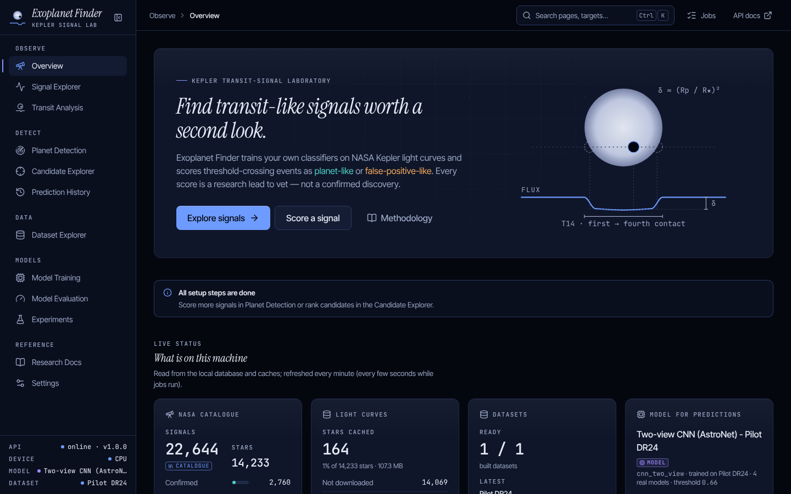
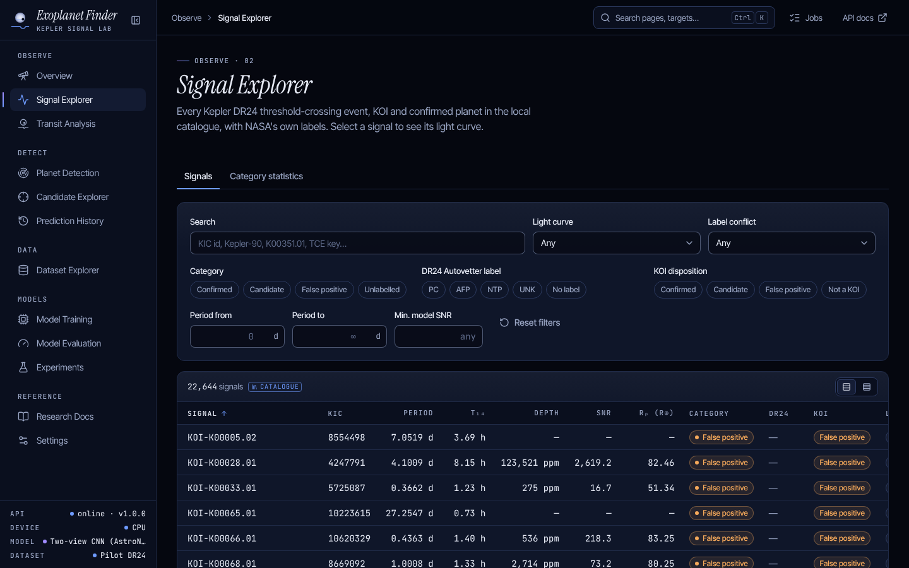
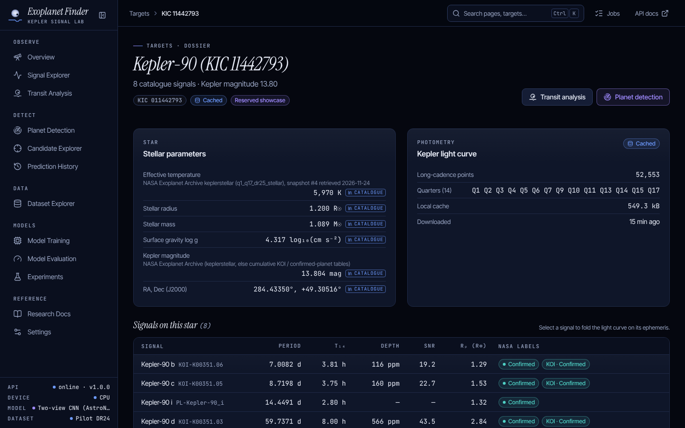
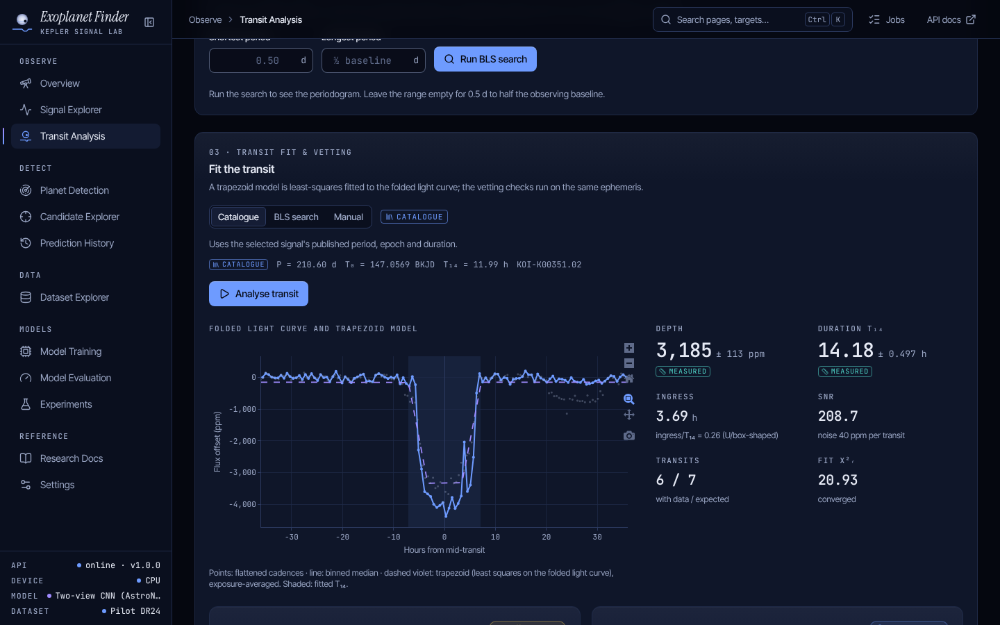
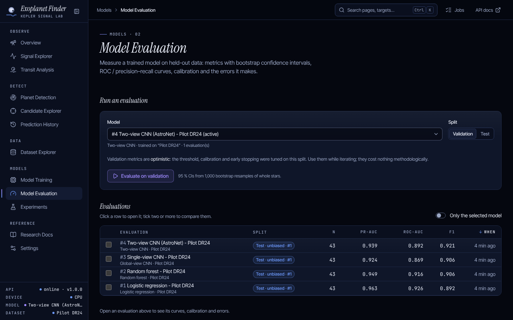
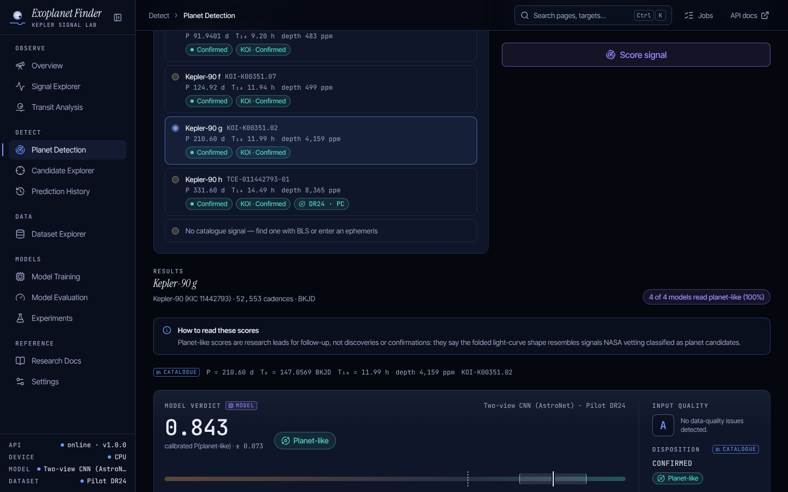

# Exoplanet Finder

**Train your own AI to vet planet signals in real NASA Kepler data, on your own computer.**

Exoplanet Finder is a local research application. It downloads public NASA Kepler data, processes
light curves into the "global" and "local" views used by the AstroNet research model, trains four
machine-learning models from scratch, and scores transit-like signals as

* **class 1, planet-like**, or
* **class 0, false-positive-like** (eclipsing binaries, background blends, instrumental artefacts…).

Everything runs on your machine: no accounts, no API keys, no paid or external AI services. The
models are trained on your computer from NASA data that you download.

> **A planet-like score is a research lead, not a discovery.** Confirming a planet needs independent
> follow-up (centroid analysis, imaging, radial velocities, statistical validation). See
> [Limitations](docs/limitations.md).

---

## Contents
1. [What you can do](#what-you-can-do)
2. [Screenshots](#screenshots)
3. [Installation (Windows)](#installation-windows)
4. [Installation (macOS / Linux)](#installation-macos--linux)
5. [Run with Docker](#run-with-docker)
6. [Start and stop](#start-and-stop)
7. [Your first research session](#your-first-research-session)
8. [The pages](#the-pages)
9. [Command line](#command-line)
10. [How it works](#how-it-works)
11. [Tech stack](#tech-stack)
12. [Testing](#testing)
13. [Troubleshooting](#troubleshooting)
14. [Project layout](#project-layout)
15. [Limitations](#limitations)
16. [Documentation](#documentation)
17. [License](#license)
18. [Credits and data acknowledgement](#credits-and-data-acknowledgement)

---

## What you can do
* **Explore NASA's Kepler catalogue**: about 20 000 Threshold Crossing Events (DR24), 9 500 Kepler Objects of
  Interest and every confirmed Kepler planet, with labels shown side by side and conflicts flagged.
* **Download real light curves** from NASA MAST (Kepler long cadence, quarters Q0–Q17). Downloads are
  resumable and verified.
* **Inspect any star**: raw, normalised, detrended and phase-folded light curves; a BLS period search;
  transit fitting; odd/even and secondary-eclipse tests; injection–recovery experiments.
* **Build datasets** at three sizes (Pilot ≈300, Standard ≈3 000, Full ≈15 700 signals). Train,
  validation and test sets are split **by star**, so the same star never appears in two splits, and
  famous systems such as Kepler-90 are kept for the test set.
* **Train four models** and compare them on identical data:
  logistic regression, random forest, a single-view CNN and a two-view CNN (AstroNet-style).
* **Evaluate honestly** on the held-out test set: accuracy, precision, recall, specificity, F1, ROC-AUC,
  PR-AUC, confusion matrix, Brier score, calibration (ECE and reliability diagram), inference time, and
  95 % bootstrap confidence intervals.
* **Score signals** from the catalogue or from your own uploaded FITS/CSV light curves. Each score comes
  with a calibrated probability, an uncertainty, a data-quality grade, and a note on whether the star was
  part of training.
* **Track experiments** in a local database and download reports (Markdown, HTML, JSON).

---

## Screenshots

Captured from a fresh install after refreshing the NASA catalogue and building and training on the
*Pilot* tier (about 300 signals); the numbers shown come from that small run, not from the
[reference results](docs/reference-results.md).

| | |
|---|---|
|  **Overview**: status and next steps |  **Signal Explorer**: 22 644 NASA signals |
|  **Target Dossier**: Kepler-90 and its eight planets |  **Transit Analysis**: BLS, folded transit, fit |
|  **Model Evaluation**: held-out test metrics |  **Planet Detection**: scores with uncertainty |

---

## Installation (Windows)

You need **Windows 10 or 11 (64-bit)**, about **25 GB of free disk** for the Standard tier (more for
Full), and an internet connection for NASA downloads. An NVIDIA GPU is optional; it is used
automatically if present.

### Step 1: Install Python 3.12
1. Go to <https://www.python.org/downloads/windows/> and download the **Windows installer (64-bit)**
   for Python **3.12** (3.11 and 3.13 also work).
2. Run it. On the first screen, **tick "Add python.exe to PATH"**, then click **Install Now**.
3. Open a new **PowerShell** window (Start menu, type *PowerShell*) and check:
   ```powershell
   py --version
   ```
   It should print `Python 3.12.x`.

### Step 2: Install Node.js 22 LTS
1. Go to <https://nodejs.org/> and download the **LTS** Windows installer (`.msi`, version 20 or newer).
2. Run it with the default options.
3. In a **new** PowerShell window:
   ```powershell
   node --version
   ```

### Step 3: Get the project
* With Git: `git clone https://github.com/aarushagrawal267-maker/exoplanet-finder.git Exoplanet-finder`
* Or download the ZIP from GitHub (**Code → Download ZIP**) and extract it, for example to
  `C:\Users\<you>\Exoplanet-finder`.

Keep the folder **outside OneDrive** (on Windows 11, Desktop and Documents are usually synced by
OneDrive, which would upload many GB of downloaded data and can lock files while the app writes them),
and prefer a short path such as `C:\Users\<you>\Exoplanet-finder` or `C:\Exoplanet-finder`.

### Step 4: Run the setup script
Open PowerShell **in the project folder** (in File Explorer, open the folder, then type
`powershell` in the address bar and press Enter) and run:

```powershell
powershell -ExecutionPolicy Bypass -File .\setup.ps1
```

The script:
* creates a private Python environment in `.venv`;
* installs PyTorch (the CUDA build if `nvidia-smi` finds an NVIDIA GPU, otherwise CPU; use
  `-Cpu` to force CPU);
* installs the Python packages from `requirements.txt` and the frontend packages;
* creates `.env` from `.env.example` and the `data/` folders;
* runs `exofinder doctor` to check the installation.

It takes 5–15 minutes, mostly downloading PyTorch. You only need to run it once, or again after an
update.

---

## Installation (macOS / Linux)

You need Python 3.11–3.13, Node.js 20.19 or newer, and `git`.

```bash
git clone https://github.com/aarushagrawal267-maker/exoplanet-finder.git
cd exoplanet-finder
scripts/setup.sh          # creates .venv, installs PyTorch + requirements + frontend packages
scripts/start.sh          # backend on :8000, web app on :5173
# open http://localhost:5173 ; stop with: scripts/stop.sh
```

On a machine without a GPU you can save about 2 GB by installing the CPU build of PyTorch first:
`python3 -m venv .venv && .venv/bin/pip install "torch>=2.6,<2.16" --index-url https://download.pytorch.org/whl/cpu`,
then run `scripts/setup.sh`.

---

## Run with Docker

A single container serves both the API and the built web app (CPU only):

```bash
docker build -t exoplanet-finder .
docker run --rm -p 8000:8000 \
  -v exof-data:/home/user/app/data -v exof-artifacts:/home/user/app/artifacts exoplanet-finder
```

Open <http://localhost:8000>; the interactive API documentation is then at
<http://localhost:8000/api/docs> (the web app uses `/docs` for its Research Docs page). The two
volumes keep downloaded NASA data and trained models between runs. The same image can be published as
a free Hugging Face Space: see [deploy/huggingface/README.md](deploy/huggingface/README.md).

---

## Start and stop

```powershell
powershell -ExecutionPolicy Bypass -File .\start.ps1
```

This starts the backend and the web interface, waits until they respond, and opens your browser:

| What | Address |
|---|---|
| Web application | <http://localhost:5173> |
| Backend API | <http://localhost:8000> |
| Interactive API documentation | <http://localhost:8000/docs> |

To stop everything:

```powershell
powershell -ExecutionPolicy Bypass -File .\stop.ps1
```

Logs are written to `logs\backend.log` and `logs\frontend.log`. Use `.\start.ps1 -NoBrowser` to
start without opening the browser.

> **macOS / Linux:** use `scripts/setup.sh`, `scripts/start.sh` and `scripts/stop.sh`, which do the same.

---

## Your first research session

The **Overview** page always shows the next step for your installation. A typical first session:

1. **Load the NASA catalogue.** Overview → *Refresh catalogue* (1–6 minutes, depending on the connection). This downloads the
   DR24 TCE table, the KOI table, the confirmed-planet list and stellar parameters from the NASA
   Exoplanet Archive. Each snapshot is stored with its query, timestamp and SHA-256.
2. **Look at a famous system.** Search for `Kepler-90` (Ctrl+K). The **Target Dossier** shows its
   eight planets with NASA's labels. Click *Download light curve* (about 18 quarter files, around 8 MB).
3. **Explore the signal.** In **Signal Explorer** and **Transit Analysis**, view the light curve at
   each processing stage, fold it on a planet's period, run BLS, and fit the transit.
4. **Build a dataset.** In **Dataset Explorer**, choose the *Pilot* tier for a quick end-to-end run
   (≈300 signals on 167 stars) or *Standard* for real experiments (≈3 000 signals on 1 976 stars).
   Missing light curves are downloaded automatically. Each star is about 8 MB of FITS data (raw files
   are deleted after conversion; the stored cache is about 0.7 MB per star). The Standard tier
   therefore downloads about 16 GB, which takes roughly 15 minutes on a fast connection and longer on
   a home connection. Downloads resume if interrupted.
5. **Train.** In **Model Training**, train one model or the whole suite (all four models on the same
   dataset). Training curves update live.

   *Measured on a 4-core CPU (no GPU), with other work running:* building the Standard dataset took
   31 minutes of processing; training the suite took 14 minutes (logistic regression 9 s, random
   forest 18 s, single-view CNN 3 min, two-view CNN 10 min). On the Full tier (≈15 500 signals,
   ≈9 900 stars, about 6 GB of light-curve cache) processing took about 2.5 hours and training the
   suite 28 minutes. A Pilot dataset is processed in about 2–3 minutes.

   **Reference results** on held-out test stars: on the Full tier, the two-view CNN reaches ROC-AUC
   0.988 and PR-AUC 0.965 at NASA's natural class balance. See
   [Reference results](docs/reference-results.md).
6. **Evaluate.** In **Model Evaluation**, run the final evaluation on the held-out **test** set and
   compare models. The test set is used only here; model choices are made on the validation set.
7. **Detect.** In **Planet Detection**, score a catalogue signal or upload your own light curve.
   **Candidate Explorer** ranks NASA's unconfirmed KOI candidates by model score.
8. **Report.** In **Experiments**, compare runs and download a report.

---

## The pages

| Page | Purpose |
|---|---|
| **Overview** | Status of catalogue, data, datasets, models and jobs; next steps |
| **Signal Explorer** | Browse and filter all catalogue signals; light-curve viewer with every processing stage |
| **Transit Analysis** | BLS periodogram, folded transit, trapezoid fit, odd/even and secondary-eclipse tests, injection–recovery |
| **Planet Detection** | Score a catalogue signal or an uploaded FITS/CSV light curve with one or more models |
| **Candidate Explorer** | Rank KOI candidates the models have not trained on, by model score, agreement between models and uncertainty, with each one's data-quality grade |
| **Prediction History** | Every prediction made, with model, inputs and data quality |
| **Dataset Explorer** | Download tiers, build datasets, inspect class balance, splits, exclusions and example views |
| **Model Training** | Model cards, configuration, live training curves, training suite |
| **Model Evaluation** | Test/validation metrics with confidence intervals, ROC/PR curves, calibration, confusion matrix, error analysis |
| **Experiments** | Experiment log, comparison, notes and tags, downloadable reports |
| **Target Dossier** | Everything about one star: stellar parameters, signals, labels, light curve, predictions |
| **Research Docs** | Methodology, data sources and limitations, inside the app |
| **Settings** | Device, download workers, storage use and clean-up, database backup |

---

## Command line

Everything in the interface is also available from the command line. Open PowerShell in the project
folder and activate the environment first (Windows blocks scripts such as `Activate.ps1` by default;
the first line allows them for this PowerShell window only):

```powershell
Set-ExecutionPolicy -Scope Process -ExecutionPolicy Bypass
.\.venv\Scripts\Activate.ps1
```

Without activating, call the program by its path instead, e.g. `.\.venv\Scripts\exofinder status`.

| Command | What it does |
|---|---|
| `exofinder doctor` | Check the installation (add `--no-network` to skip NASA checks) |
| `exofinder refresh-catalog` | Download the NASA catalogue snapshots |
| `exofinder download --tier pilot` | Download light curves for a tier (or `--kepid 11442793`) |
| `exofinder build-dataset --tier standard --name "Standard DR24"` | Build a dataset |
| `exofinder train-suite --dataset 1` | Train all four models |
| `exofinder evaluate --model 3 --split test` | Final test evaluation |
| `exofinder predict --kepid 11442793` | Score the signals of a star with the active model |
| `exofinder status` | Summary of data, datasets, models and jobs |

Run `exofinder <command> --help` for all options.

---

## How it works

```
NASA Exoplanet Archive (TAP) ──► catalogue snapshots (labels, ephemerides, stellar parameters)
NASA MAST ──► Kepler long-cadence FITS ──► stitched light curve per star
        │
        ▼
quality flags ─► per-quarter normalisation ─► spline detrending (transits masked)
        ─► outlier clipping ─► phase folding ─► global view (2001 bins) + local view (201 bins)
        │
        ▼
quality gates ─► star-level train/val/test split ─► LR · RF · 1-view CNN · 2-view CNN
        │
        ▼
calibration (validation) ─► one-time test evaluation ─► predictions with uncertainty
```

* **Labels** (default): the DR24 Autovetter training set, PC → planet-like; AFP and NTP →
  false-positive-like. An alternative mode uses KOI dispositions (CONFIRMED vs FALSE POSITIVE), in
  which KOI candidates are never used for training. In the default mode, Autovetter "PC" signals that
  NASA still lists as KOI CANDIDATE are planet-like training examples, as in AstroNet; the Candidate
  Explorer therefore hides candidates whose star a model trained or validated on.
* **No leakage:** splits by star; catalogue scores such as `koi_score` are never model inputs;
  thresholds and calibration use only the validation set.
* Full details: [Methodology](docs/methodology.md), [Data sources](docs/data-sources.md),
  [Pipeline](docs/pipeline.md), [Models](docs/models.md), [Evaluation](docs/evaluation.md).

**Technology:** FastAPI, SQLAlchemy and SQLite; PyTorch, scikit-learn, NumPy, SciPy and pandas;
Astropy, Astroquery and Lightkurve; React, TypeScript, Vite, Tailwind, Recharts, Plotly.js and Lucide.

---

## Tech stack

| Layer | Technology |
|---|---|
| Backend API | Python 3.11–3.13, FastAPI, Uvicorn, Pydantic, SQLAlchemy, SQLite |
| Astronomy | Astropy (FITS, BLS periodogram), Astroquery, Lightkurve, NumPy, SciPy, pandas |
| Machine learning | PyTorch (single-view and two-view CNNs), scikit-learn (logistic regression, random forest, calibration) |
| Frontend | React 18, TypeScript, Vite, Tailwind CSS, TanStack Query/Table, Recharts, Plotly.js, Lucide icons |
| Testing | pytest, Ruff, Vitest, React Testing Library, Playwright |
| Data | NASA Exoplanet Archive (TAP), NASA MAST (Kepler long-cadence FITS) |
| Deployment | Windows PowerShell scripts, Bash scripts, Docker, Hugging Face Spaces |

---

## Testing

```powershell
powershell -ExecutionPolicy Bypass -File .\scripts\test.ps1
```

(macOS / Linux: `scripts/test.sh`, add `--skip-e2e` to skip the browser tests.)

This runs the backend tests (pytest), frontend unit tests (Vitest and React Testing Library) and
end-to-end browser tests (Playwright). The test tools (pytest, Ruff) are not installed by setup; the
test script installs them from `requirements-dev.txt` the first time. Individually:

```powershell
.\.venv\Scripts\python -m pip install -r requirements-dev.txt   # once: pytest and Ruff
cd backend;  ..\.venv\Scripts\python -m pytest            # backend unit + API tests (offline)
cd backend;  ..\.venv\Scripts\python -m pytest -m network  # live NASA checks (needs internet)
cd frontend; npm.cmd test                                  # frontend unit tests
cd frontend; npx.cmd playwright install chromium; npm.cmd run test:e2e   # browser tests
```

(`npm.cmd`/`npx.cmd` rather than `npm`/`npx`: in PowerShell the latter run `npm.ps1`, which the default
execution policy blocks.)

Tests use temporary folders and never touch your data. Synthetic light curves used in tests are
labelled as test data and never shown as real results.

---

## Troubleshooting

| Problem | Fix |
|---|---|
| `running scripts is disabled on this system` | Use `powershell -ExecutionPolicy Bypass -File .\start.ps1` as shown above; for `npm`/`npx` typed by hand use `npm.cmd`/`npx.cmd` |
| `py` or `python` not found | Reinstall Python with **Add python.exe to PATH** ticked, then open a new PowerShell window |
| Setup says Python version unsupported | Install Python 3.11, 3.12 or 3.13 (64-bit) |
| `Port 8000 is already in use` | Run `.\stop.ps1`; if that does not help, another program uses the port: start on another port with `.\start.ps1 -BackendPort 8010` (and stop with `.\stop.ps1 -BackendPort 8010`) |
| Setup: `PyTorch is installed but cannot be loaded` (`[WinError 126]`, `DLL load failed`) | Install the Microsoft Visual C++ Redistributable (X64) from <https://learn.microsoft.com/cpp/windows/latest-supported-vc-redist>, then re-run setup |
| Setup: pip fails with `No such file or directory` / long-path hint | The project path is too long for Windows' 260-character limit: move it to e.g. `C:\Exoplanet-finder`, delete `.venv` and re-run setup (or enable long paths in Windows) |
| `npm ci` fails with `EPERM`/`EBUSY` | Stop the app (`.\stop.ps1`), close editors using the folder, delete `frontend\node_modules`, re-run setup |
| Files locked, sync conflicts or a slow app in a OneDrive folder | Move the project out of OneDrive (see Step 3) and re-run setup there |
| The page shows "API offline" | Check `logs\backend.log`; run `.\.venv\Scripts\exofinder doctor` |
| NASA downloads fail | Check your internet connection or proxy; the NASA services are sometimes down for maintenance. Downloads resume where they stopped |
| Training is slow | Use the Pilot or Standard tier; close other heavy programs; a CUDA GPU is used automatically when available |
| Disk full | Settings → Storage: clear raw FITS files and caches; or keep fewer tiers |
| Something else | Run `exofinder doctor`, then open an issue with the output and `logs\backend.log` |

---

## Project layout

```
backend/exofinder/
  astro/      light-curve processing, BLS, transit fitting, diagnostics, quality gates
  data/       NASA Exoplanet Archive and MAST clients, catalogue, labels, download tiers
  ml/         splits, datasets, models, training, calibration, evaluation, inference
  services/   application logic used by the API and the CLI
  api/        FastAPI routers and schemas
  jobs/       background job runner (progress, cancellation, live events)
  db/         SQLAlchemy models (SQLite)
  cli.py      command-line interface
backend/tests/  unit, API and integration tests (+ real NASA FITS fixtures)
frontend/       React + TypeScript web application
docs/           research and developer documentation
data/           your downloaded data and database (created on first run, not in git)
artifacts/      trained models and reports (created on first run)
setup.ps1, start.ps1, stop.ps1   Windows scripts
scripts/         macOS / Linux scripts (setup.sh, start.sh, stop.sh, test.sh)
Dockerfile       single-container build (API + web app)
deploy/          Hugging Face Space files
```

---

## Limitations
* Scores are **research leads**: the models rank how planet-like a signal looks; they cannot confirm a
  planet. Follow-up observations are required.
* Kepler long-cadence data only (no TESS, no short cadence). Uploaded light curves from other missions
  can be scored, but the models were trained on Kepler, so such scores are out of distribution.
* Labels come from NASA's DR24 Autovetter and KOI dispositions, which contain some errors; 150 label
  conflicts are flagged in the catalogue.
* A fresh install contains no data or trained models: the first session downloads the NASA catalogue
  and light curves and trains the models on your computer (minutes for Pilot, about an hour for
  Standard on a 4-core CPU).
* Full details: [docs/limitations.md](docs/limitations.md).

---

## Documentation
* [Methodology](docs/methodology.md): the science and the research protocol
* [Data sources](docs/data-sources.md): NASA tables, labels, storage
* [Pipeline](docs/pipeline.md): light-curve processing and quality gates
* [Models](docs/models.md) and [Training](docs/training.md)
* [Evaluation](docs/evaluation.md): metrics, confidence intervals, calibration
* [Reference results](docs/reference-results.md): real results of the four models on the Standard and Full tiers
* [Predictions](docs/prediction.md): how to read a score
* [Experiments and reports](docs/experiments.md)
* [Limitations](docs/limitations.md)
* [Research report template](docs/research-report-template.md)
* [Architecture](docs/architecture.md) and [Testing](docs/testing.md) for developers
* [Test results and acceptance checklist](docs/test-results.md)

---

## License
Released under the [MIT License](LICENSE). NASA data downloaded by the app is public and subject to
the NASA Exoplanet Archive and MAST acknowledgement policies below.

---

## Credits and data acknowledgement
This research tool uses the NASA Exoplanet Archive, which is operated by the California Institute of
Technology under contract with the National Aeronautics and Space Administration under the Exoplanet
Exploration Program, and data from the Mikulski Archive for Space Telescopes (MAST). Kepler was
funded by the NASA Science Mission Directorate.

The two-view CNN follows Shallue & Vanderburg (2018), *AJ* 155, 94. This project is an independent
re-implementation and is not affiliated with NASA or the original authors.
